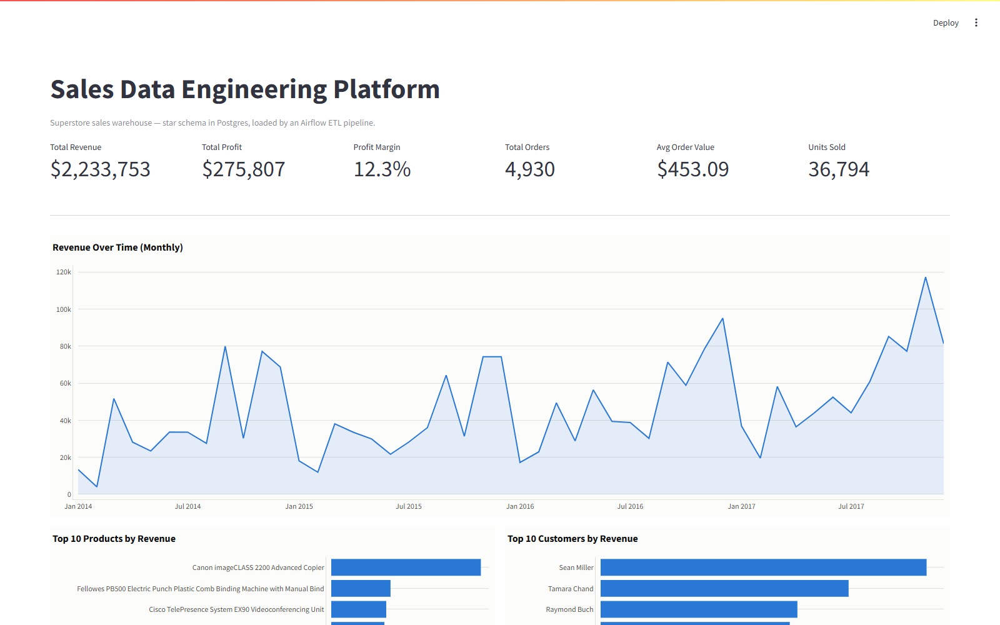
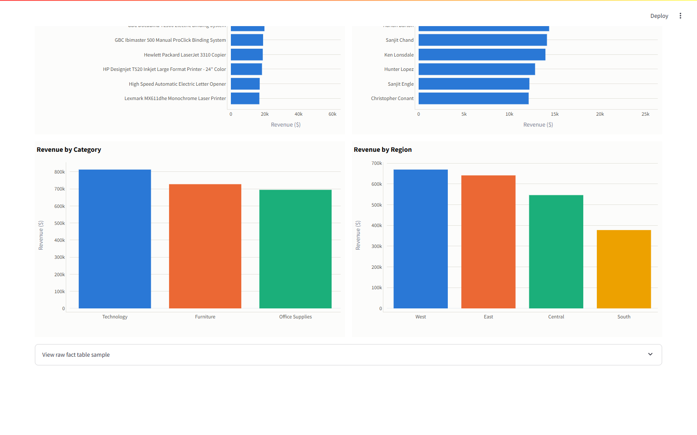

# Sales Data Engineering Platform

An end-to-end data pipeline: clean a raw sales CSV, load it into a Postgres
star-schema warehouse, orchestrate it with Airflow, and visualize it in a
Streamlit dashboard. Runs entirely locally via Docker Compose.

## Stack

- **Python + pandas** — extraction and cleaning
- **PostgreSQL** — data warehouse (star schema)
- **Apache Airflow** — orchestration (one scheduled DAG)
- **Streamlit + Plotly** — dashboard
- **Docker Compose** — everything runs locally, 5 containers

## Dashboard





## Data

The "Sample Superstore" dataset (9,994 order line items: orders, customers,
products, 2014–2017) — the same dataset widely known on Kaggle as
"Superstore Sales".

**Note:** the public CSV is already clean, so there's nothing for a cleaning
pipeline to catch. `etl/make_raw_extract.py` seeds a raw extract from it
(fixed random seed) with realistic problems injected on purpose — duplicate
rows, missing values, negative sales, zero quantities, malformed dates,
ship-before-order dates — to simulate a real messy source. The cleaning
numbers below are genuinely produced by the pipeline, cleaning up issues
that were deliberately introduced for the demo.

## Architecture

```
superstore.csv (clean)
      │  make_raw_extract.py  →  injects realistic data issues
      ▼
superstore_raw.csv  ──▶  etl/etl.py  ──▶  Postgres star schema  ──▶  Streamlit
                         extract,          (fact_sales +
                         clean,             dim_customer,
                         transform,         dim_product,
                         load               dim_date)
                              ▲
                         Airflow DAG (sales_etl_pipeline, @daily)
```

`fact_sales` (one row per order line item) references `dim_customer`,
`dim_product`, and `dim_date`. Schema DDL in `sql/schema.sql`.

## Results from the last pipeline run

| Metric | Value |
|---|---|
| Rows extracted | 10,193 |
| Duplicate rows removed | 168 |
| Dropped — missing required fields | 153 |
| Postal codes filled (`UNKNOWN`) | 51 |
| Dropped — invalid/unparseable dates | 31 |
| Dropped — ship date before order date | 27 |
| Dropped — invalid sales (≤ 0) | 49 |
| Dropped — invalid quantity (≤ 0) | 49 |
| **Total bad records removed** | **477 (4.7%)** |
| Rows loaded into `fact_sales` | 9,716 |
| Total revenue loaded | $2,233,753 |

Full JSON: `logs/etl_run_summary.json` (regenerated every run).

## How to run it

```bash
# 1. Start Postgres (warehouse + Airflow metadata), Airflow, and Streamlit
docker compose up -d --build

# 2. Once airflow-webserver is healthy, trigger the DAG
docker compose exec airflow-webserver airflow dags trigger sales_etl_pipeline

# 3. Open the UIs
# Airflow:   http://localhost:8080  (admin / admin)
# Streamlit: http://localhost:8501
```

The DAG is scheduled `@daily` and unpaused by default — triggering manually
just runs it immediately. Every run truncates and reloads all four tables,
so it's safe to re-run.

To run the ETL directly without Airflow:

```bash
pip install -r requirements.txt
python etl/etl.py
```

## What each piece does

- **`etl/etl.py`** — extract → clean (duplicates, missing fields, invalid
  dates/amounts, each counted) → transform into the star schema → load via
  psycopg2.
- **`sql/schema.sql`** — warehouse DDL, applied automatically by the ETL
  script.
- **`dags/sales_etl_dag.py`** — single-task Airflow DAG, `@daily`.
- **`streamlit/app.py`** — one SQL join across the star schema, 6 KPI tiles
  and 4 charts.
- **`docker-compose.yaml`** — Airflow's metadata DB is kept separate from the
  warehouse (how real Airflow deployments are structured); LocalExecutor
  since a single-task DAG doesn't need distributed execution.

## Known simplifications

- LocalExecutor instead of Celery/Kubernetes — fine for one lightweight task.
- No dbt — SQL is applied directly by the Python script.
- No data-quality framework (e.g. Great Expectations) — validation rules are
  hand-written in `clean()`.
- Credentials are hardcoded for local demo convenience, not production use.
